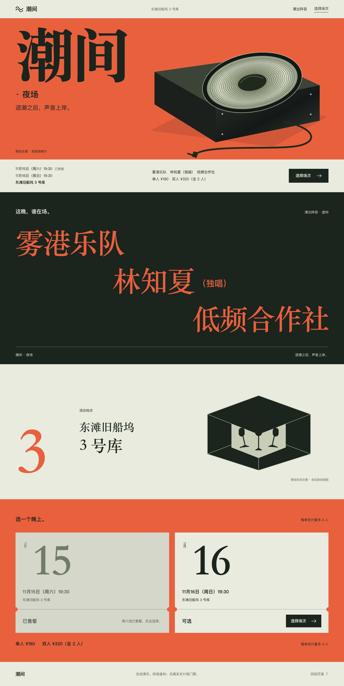
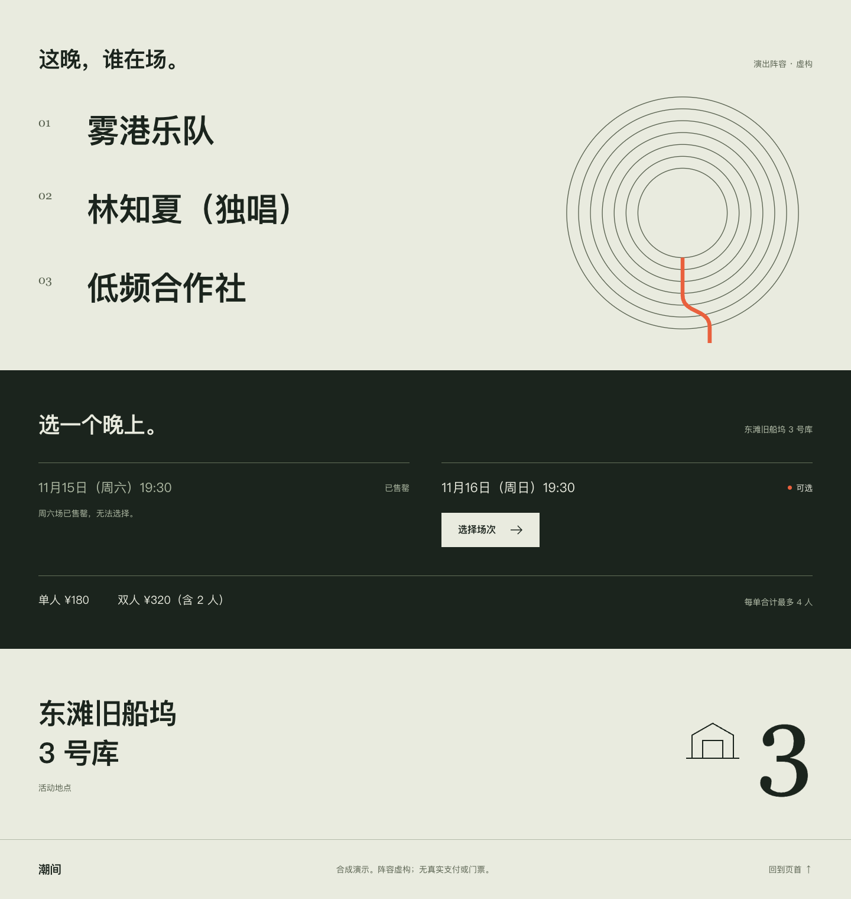
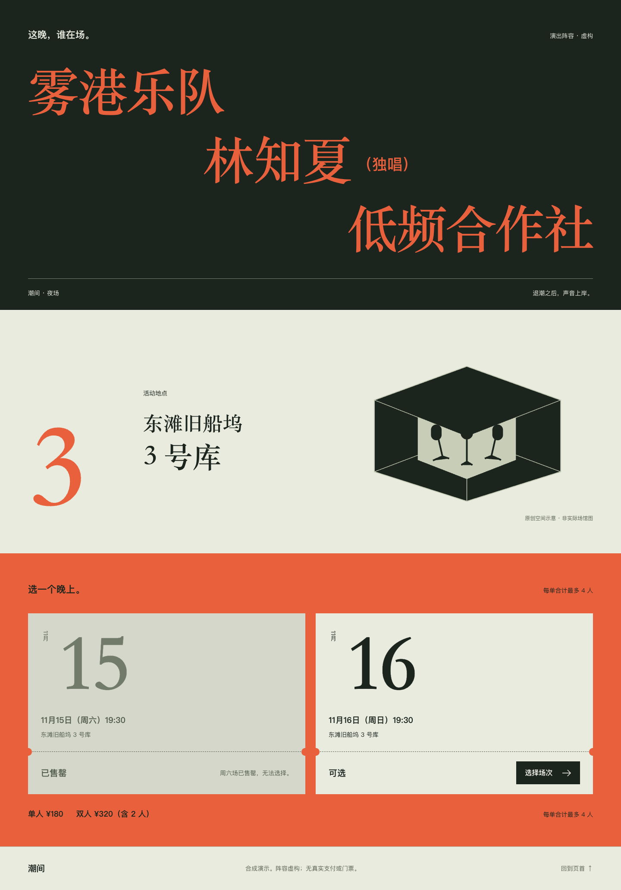
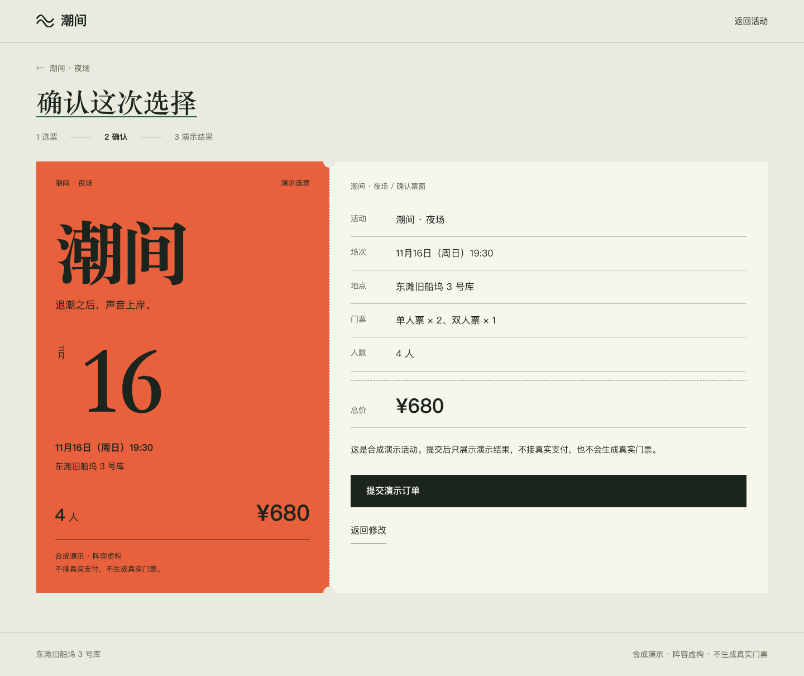
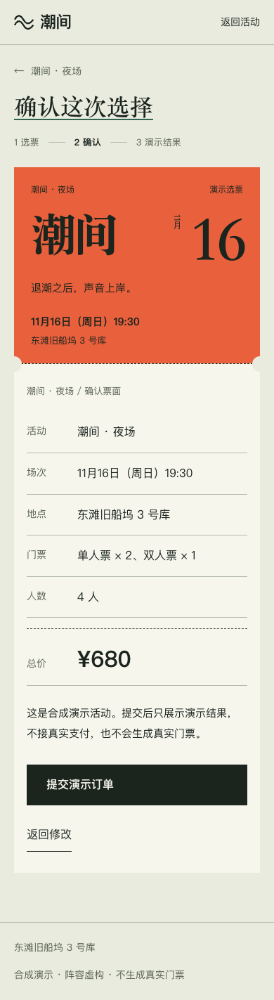

# 潮间：从首屏概念到整套活动物料

本例使用固定的合成活动事实，展示从首屏到后续主流程的概念延续。它是教学副本，没有独立评分；来源文件哈希、改动及边界见 [SOURCE.json](SOURCE.json)。

## 先看实际画面

以下是随案例保留的实际渲染图，文件哈希见 SOURCE.json。先看图学习关系；要验证选择、确认和刷新行为时再按后文运行页面。这些图片没有独立分数，也不证明真实200%通过。

首屏正向起点及改好整套：已选橙色、宋体和原创扬声器保持原样。

隐藏首屏的旧下半：重复振膜、通用场次块与建筑图标的关系不足。

隐藏首屏的教学正稿：阵容、场馆地址与可操作日期票面继续同一套活动物料。

桌面和手机确认：当前日期、票种、人数和演示提交处于同一张票面的票头/操作票根，保留真实边界。

## 同一方向内，什么关系继续，什么关系改变

已选首屏 A 以橙底、宋体和斜置原创扬声器说明夜场声音上岸。它是本例的正向起点，[旧版首页](before/index.html)保留了首屏和旧下半页；[新整套](after/index.html)继续沿用首屏，没有重新探索方向或换字体。

首屏的海报气质不能只作为开场装饰。后续内容有各自的任务，概念应改变它们的构图和操作关系：

| 内容 | 旧版的断裂 | 教学稿的转化 |
| --- | --- | --- |
| 演出阵容 | 通用名字列表旁加同心圆；圆虽像振膜，却不改变名字的阅读关系 | 深色整张阵容海报，宋体名字在同一画布上错位展开。名字是主角，既有顺序不被包装成节目顺序 |
| 场馆 | 默认建筑图标加数字，像独立信息组件 | 把库号作为地址标识，和完整场馆名、明确标为原创空间示意的库房图共同组成场馆页签；示意不宣称实际布局 |
| 场次 | 两栏日期与按钮，和首屏没有结构关系 | 日期成为可辨识票面；售罄/可选及动作位于各自票根，状态直接决定是否存在选择入口 |
| 选票与确认 | 默认表单加一张小扬声器摘要；首屏主角缩成侧栏装饰 | 同一张分区票面：活动、日期与场馆是票头，输入与核对是票根。确认保留当前场次和数量，主动作仍如实说明演示提交 |

这不是要求每屏都放扬声器，更不是把同心圆重复到各处。重复振膜只重复了外形，没有建立“阵容 → 地点 → 可选场次 → 本次选择”的关系，是本例的伪贯穿反例。

## 实际比较路径

1. 先看[旧首页](before/index.html)首屏，记下主角、比例、字体和色彩关系。
2. 隐藏首屏，只看旧版 `#lineup` 以下及[旧确认](before/tickets.html?session=sun&single=2&double=1#confirm)。说清哪里退回通用模块，不用“我不喜欢”代替证据。
3. 同样隐藏首屏，看[新下半页](after/index.html#lineup)，再从可选场次进入[选票](after/tickets.html?session=sun&single=2&double=1)，核对并看确认。下半和确认应仍能识别为同一套活动物料，而不是只有首屏属于这个活动。

## 迁移时借关系，不抄外壳

可迁移的是：选定概念如何改变核心内容的主次和对象形态；状态与可操作入口怎样进入这种形态；下一页怎样保持对象、选择及事实；如何在没有首屏帮助时检查连续性。

橙底巨字、宋体海报、斜置扬声器、票根齿口和库号排版只属于这个夜场方向，不应机械复制到医疗、财务或日常工作台。其他品牌与业务先使用自己的事实、对象、操作及获批方向；纸纹、写实材质、转场动画都不是迁移门槛。

## 事实、运行与恢复边界

固定事实见 `content.json`，来源及原七文件 SHA 见 `SOURCE.json`。没有补真实艺人、背书、节目顺序、观众数或新价格。周六售罄，混合票种最多 4 人；2 单人 + 1 双人为 ¥680。所有提交仅本地演示，没有真实支付、订单或门票。

本地运行：`node server.mjs`，使用其返回的 `127.0.0.1` 地址。前后两套是同一固定任务的教学副本。

旧件的完成页刷新缺陷只在 `after/app.js` 修正：结果不持久化；刷新或直达 `#demo-complete` 时以保留的选择进入确认并把 URL 改为 `#confirm`，明确提示结果未保存、尚未重新提交。无效选择则回选票并清除完成锚点。不能把恢复草稿写成恢复订单。

票务、刷新、窄屏和键盘检查由实现者执行；维护者另行看图认可整体连续性。两者不混写成独立打分，本例不声称 9 分或稳定质量提升。
